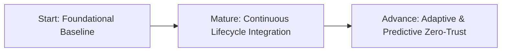

# Enterprise Application Security Design Principles & Maturity Model

> **Status**: Primary Architectural Standard  
> **Authoritative Scope**: Application Security, DevSecOps, Compliance Governance & System Architecture  
> **Primary Safe Folder**: `.agents/skills/application-security-design-principles/`  
> **Unabridged References**: `references/application-security-design-principles.md` & `references/application-security-standard.txt`  
> **Enterprise Knowledge Base**: `.github/knowledge/security/application-security-design-principles.md`

---

## 1. Executive Summary & The 5 Core Principles

Robust Application Security is not an operational afterthought; it is a foundational architectural invariant. This primary standard establishes five core design principles to build, audit, and maintain secure, compliant, and resilient systems:

```
+---------------------------------------------------------------------------------------------------+
|                        5 APPLICATION SECURITY DESIGN PRINCIPLES                                   |
+---------------------------------------------------------------------------------------------------+
| 1. Design for Security   : Embed defense-in-depth across code, runtime, and supply chain.         |
| 2. Design for Compliance : Proactively align architecture with regulatory and legal requirements. |
| 3. Design for Proactivity: Shift-left threat anticipation and pre-emptive vulnerability hunting.  |
| 4. Design for Awareness  : Inculcate security vigilance, onboarding, and leadership engagement.  |
| 5. Keep it Simple        : Eliminate accidental complexity; enforce clear, manageable controls.   |
+---------------------------------------------------------------------------------------------------+
```

---

## 2. Progressive Maturity Architecture: 3 Tiers

Every system, team, and repository advances through three distinct maturity stages:



### Stage 1: Start (Foundational Baseline)
* **Goal**: Establish baseline secure coding hygiene, role-based education, and least-privilege access controls.
* **Key Practices**:
  * Incorporate security measures at every layer (client, gateway, backend, database).
  * Enforce strict Zod schemas and parameterized database queries.
  * Document all applicable regulatory requirements (FERPA, GDPR, SOC 2).
  * Integrate security awareness into all new developer onboarding.
  * Maintain a centralized, accessible repository of internal security guidelines.

### Stage 2: Mature (Continuous Lifecycle Integration)
* **Goal**: Proactive vulnerability detection across the software development lifecycle (SDLC) and supply chain.
* **Key Practices**:
  * Automated SAST, DAST, and Dependabot vulnerability scanning in CI/CD.
  * Dedicated developer incident response runbooks for sensitive crown jewels.
  * Formal data classification by sensitivity tiers (Public, Internal, Confidential, Restricted).
  * Comprehensive software bill of materials (SBOM) and asset inventory tracking.
  * Active Security Champions program embedding leads into cross-functional squads.
  * Blameless security post-mortems and proactive recognition systems.

### Stage 3: Advance (Adaptive & Predictive Zero-Trust)
* **Goal**: Forward-looking AI/ML threat forecasting, policy-as-code, and isolated ephemeral runtimes.
* **Key Practices**:
  * Predictive threat analytics anticipating zero-day exploits before manifestation.
  * Codified security policies enforced as quality gates on pull requests.
  * Isolated, ephemeral, and secure build runtimes (e.g. non-root ARC runners with DinD sidecars).
  * Secure-by-default configurations across all environments (closed by default).
  * Full Zero-Trust verification: continuous per-request token evaluation and mutual TLS.
  * Active threat intelligence sharing and external vulnerability research participation.

---

## 3. Implementation Matrix: Approach vs Benefit

### 3.1 Design for Security

| Maturity Stage | Approach | Architectural Benefit |
| :--- | :--- | :--- |
| **Start** | Incorporate security at every layer | Prevents single-point compromise; protects confidentiality and integrity. |
| **Start** | Establish secure coding guidelines | Standardizes safe practices and minimizes common OWASP Top 10 flaws. |
| **Start** | Role-based security training | Equips engineers with threat-modeling skills tailored to their specific domains. |
| **Start** | Implement strong access controls | Least-privilege role bindings limit blast radius and unauthorized access. |
| **Mature** | Proactive source code audits in SDLC | Detects and remediates vulnerabilities before staging or production rollout. |
| **Mature** | Dedicated source code incident response | Minimizes operational downtime and preserves stakeholder trust during incidents. |
| **Mature** | Data classification by sensitivity | Right-sizes cryptographic controls and access tiers according to risk. |
| **Mature** | Continuous supply-chain defense | Neutralizes vulnerable third-party packages (`npm audit`, Dependabot). |
| **Advance** | AI & predictive threat analytics | Forecasts threat campaigns and automates real-time anomaly triage. |
| **Advance** | Codified CI/CD security quality gates | Enforces non-negotiable security gates without impeding release velocity. |
| **Advance** | Ephemeral, isolated build runtimes | Eliminates runner persistence attacks and build-environment poisoning. |

### 3.2 Design for Compliance

| Maturity Stage | Approach | Architectural Benefit |
| :--- | :--- | :--- |
| **Start** | Document applicable regulations | Provides a clear roadmap for legal alignment and risk gap identification. |
| **Start** | Early SDLC compliance verifications | Eliminates the costly friction of retrofitting compliance late in release cycles. |
| **Mature** | Automated compliance scanning | Detects regulatory drift in real-time with automated issue dispatch. |
| **Mature** | Horizon scanning for upcoming rules | Enables proactive architectural adaptation before new regulations take effect. |
| **Advance** | Advanced data governance frameworks | Cryptographically verifiable audit ledgers guarantee regulatory compliance. |
| **Advance** | Active regulatory body engagement | Shapes future standards and gains early strategic regulatory insights. |

### 3.3 Design for Proactivity

| Maturity Stage | Approach | Architectural Benefit |
| :--- | :--- | :--- |
| **Start** | Documented secure SDLC policy | Establishes a formal baseline for secure engineering expectations. |
| **Start** | Centralized vulnerability reporting | Accelerates discovery and remediation of internal/external findings. |
| **Mature** | Security Champion program | Embeds direct security leadership into product engineering squads. |
| **Mature** | Developer incident response runbooks | Empowers squads to execute immediate targeted containment. |
| **Advance** | Zero-Trust platform architecture | Assumes hostile networks; verifies every identity, request, and token. |
| **Advance** | Coordinated security research | Bug bounties and threat research uncover edge-case vulnerabilities. |

### 3.4 Design for Awareness

| Maturity Stage | Approach | Architectural Benefit |
| :--- | :--- | :--- |
| **Start** | Security-first employee onboarding | Imparts security responsibilities and cultural expectations from day one. |
| **Start** | Centralized security knowledge hub | Provides unified, accessible guidelines, runbooks, and contact rosters. |
| **Mature** | Transparent post-mortems & drills | Fosters an open culture of continuous learning from real-world events. |
| **Mature** | Reward proactive security behaviors | Incentivizes developers who identify and report potential security flaws. |
| **Advance** | Executive leadership sponsorship | Aligns security investments with business priorities from the top down. |
| **Advance** | Continuous awareness program evolution | Keeps educational content dynamically synchronized with emerging attack trends. |

### 3.5 Keep it Simple

| Approach | Architectural Benefit |
| :--- | :--- |
| **Implement straightforward, manageable controls** | Avoids overengineering that causes misconfiguration, operator errors, or bypasses. |
| **Standardize on proven cryptographic primitives** | Constant-time comparisons (`timingSafeEqual`), Argon2id hashing, and strict Zod parsing. |
| **Build security early in the architecture** | Catching flaws during design is orders of magnitude less expensive than production fixes. |
| **Deploy low-noise, actionable monitoring** | Real-time anomaly detection with clear contextual links; eliminates alert fatigue. |
| **Practical, stack-relevant security training** | Focuses development attention on vulnerabilities directly relevant to TypeScript, Node, and Next.js. |

---

## 4. Architectural Verification & Enforcement Invariants

Every automated CI gate and architectural review must evaluate compliance against these primary invariants:

1. **Server-Side Tenant Scoping**: Every database transaction must resolve tenant identity from verified server session tokens (`req.user.schoolId`), never from client input.
2. **Zero Plaintext Secrets**: Secrets, tokens, and keys must never be committed to source control or logged in telemetry.
3. **Automated Quality Gates**: CI pipelines must enforce linting, typechecking, vulnerability scanning, and architecture audit gates (`npm run audit:architecture`).
4. **Zero Emojis & Clean Signal**: All security documentation, logs, error responses, and telemetry must use strict textual badges (`[PASSED]`, `[FAILED]`, `[WARNING]`, `[P0]`, `[P1]`).
