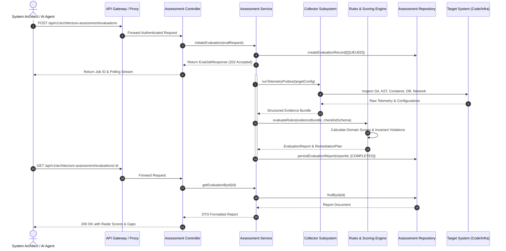
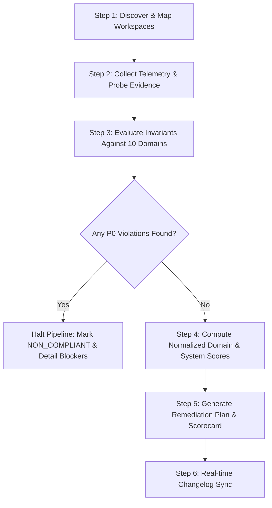
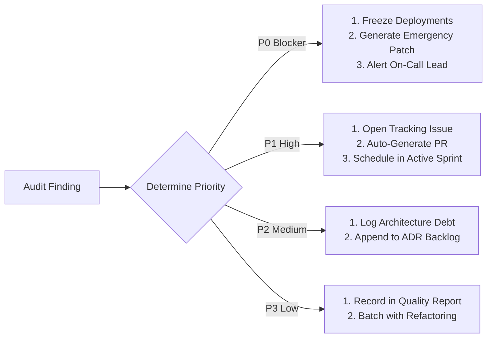

# Enterprise Architecture Assessment & Systems Audit Framework

This specification defines the authoritative **Enterprise Architecture Assessment Framework**, automated audit pipeline, 7-layer REST API architecture, AI Agent operational protocol, and comprehensive multi-domain checklist for modern software systems, modular monoliths, and distributed cloud deployments.

> **Primary Skill Safe Folder**: `.agents/skills/architecture-assessment-audit/`  
> **Unabridged Markdown Article**: `references/architecture-assessment-framework.md` (and `references/architecture-assessment-article.md`)  
> **Plaintext Standard Reference**: `references/architecture-assessment-standard.txt`

---

## 1. Architectural Assessment Pillars & Weighting Model

The framework evaluates system architecture across **10 core domains** using a normalized mathematical scoring model:

$$\text{Architecture Score } (S_{\text{total}}) = \sum_{i=1}^{10} w_i \cdot S_i \quad \text{where} \quad \sum_{i=1}^{10} w_i = 1.0$$

| Domain Code | Architectural Domain | Weight ($w_i$) | Core Objective | Primary Risk Target |
| :--- | :--- | :--- | :--- | :--- |
| `DOM-01` | **Scalability** | 0.12 | Throughput, growth headroom, elastic resources | Traffic bottlenecks, compute exhaustion |
| `DOM-02` | **Resiliency** | 0.14 | Fault tolerance, failover, zero single points of failure | Service outages, cascading failures |
| `DOM-03` | **Efficiency** | 0.10 | Resource optimization, profiling, cost hygiene | Resource waste, CPU/memory bloat |
| `DOM-04` | **Simplicity** | 0.08 | Straightforward topology, manageable configuration | Accidental complexity, cognitive load |
| `DOM-05` | **Documentation** | 0.08 | Up-to-date specs, API manuals, architecture ADRs | Operational blindness, onboarding drag |
| `DOM-06` | **Disaster Recovery** | 0.14 | Zero data loss, RPO/RTO verification, Git recovery | Irrecoverable data loss, catastrophic drop |
| `DOM-07` | **Modularity** | 0.10 | Loose coupling, clear boundaries, contract cohesion | Monolithic entanglements, circular dependencies |
| `DOM-08` | **Interoperability**| 0.08 | Standardized APIs, protocol compliance, cross-platform | Vendor lock-in, integration friction |
| `DOM-09` | **Observability** | 0.10 | Telemetry, structured logs, actionable alerts | Mean time to detect (MTTD) degradation |
| `DOM-10` | **GitHub Enterprise** | 0.06 | GHE Cloud & Server governance, RBAC, backups | Supply-chain breaches, access creep |

### Compliance Grading Tiers

* **Tier 1: Platinum (`>= 95%`)**: Enterprise-grade excellence. Automated verification green across all P0/P1 criteria.
* **Tier 2: Gold (`85% - 94%`)**: Production-ready. All P0 criteria fulfilled; non-critical P2/P3 items tracked in backlog.
* **Tier 3: Silver (`70% - 84%`)**: Conditional deployment. No active P0 blockers; remediation required for P1 gaps within 14 days.
* **Tier 4: Bronze (`55% - 69%`)**: Elevated architectural risk. Core deficiencies present in DR, HA, or Modularity.
* **Tier 5: Non-Compliant (`< 55%`)**: Critical failure. Production freeze enforced until all P0 violations are resolved.

---

## 2. Master MVP Architecture & Execution Flow

### High-Level System Architecture

The Assessment Engine operates as a 4-stage modular pipeline decoupled into data collectors, a rule verification engine, an automated scoring synthesizer, and a remediation dispatch module.

```
+-------------------------------------------------------------------------------------------------------+
|                                  ARCHITECTURE ASSESSMENT ENGINE (MVP)                                  |
+-------------------------------------------------------------------------------------------------------+
                                                    |
         +------------------------------------------+------------------------------------------+
         |                                          |                                          |
         v                                          v                                          v
+------------------+                       +------------------+                       +------------------+
| GitHub & Codebase|                       | Infrastructure   |                       | Runtime Engine   |
| Telemetry Probe  |                       | Health Probe     |                       | & Database Probe |
+------------------+                       +------------------+                       +------------------+
| - Repo structure |                       | - Load balancers |                       | - Express API    |
| - Custom props   |                       | - Compute nodes  |                       | - Replica set rs0|
| - Branch rules   |                       | - Scaling groups |                       | - Memory/CPU     |
| - Dependency AST |                       | - Network egress |                       | - Log telemetry  |
+------------------+                       +------------------+                       +------------------+
         |                                          |                                          |
         +------------------------------------------+------------------------------------------+
                                                    |
                                                    v
                                  +------------------------------------+
                                  |    Normalized Rules Engine (Zod)   |
                                  |   Evaluates 10-Domain Invariants   |
                                  +------------------------------------+
                                                    |
                                                    v
                                  +------------------------------------+
                                  |   Scoring & Radar Matrix Engine    |
                                  |   Calculates Domain & System Total |
                                  +------------------------------------+
                                                    |
                         +--------------------------+--------------------------+
                         |                                                     |
                         v                                                     v
          +------------------------------+                      +------------------------------+
          | Interactive Dashboard & APIs |                      | Automated Remediation Engine |
          | REST Endpoints & Webhooks    |                      | PR Generation & Alerts       |
          +------------------------------+                      +------------------------------+
```

### End-to-End Execution Flow (Mermaid Sequence)



---

## 3. 7-Layer Backend REST API Design

Adhering to the modular monolith pattern (`apps/backend/src/modules/architecture-assessment/`), the API exposes structured endpoints for automated evaluations, continuous monitoring, and attestation.

### 3.1 REST API Endpoint Matrix

| Method | Endpoint Path | Description | Access Scope |
| :--- | :--- | :--- | :--- |
| `POST` | `/api/v1/architecture-assessment/evaluations` | Trigger a new architectural evaluation run | `system:admin`, `audit:write` |
| `GET` | `/api/v1/architecture-assessment/evaluations` | List historical evaluation runs with pagination & status | `audit:read` |
| `GET` | `/api/v1/architecture-assessment/evaluations/:id` | Retrieve comprehensive evaluation report and scorecards | `audit:read` |
| `GET` | `/api/v1/architecture-assessment/evaluations/:id/domains/:domainKey` | Fetch domain-specific breakdown with itemized evidence | `audit:read` |
| `PATCH`| `/api/v1/architecture-assessment/evaluations/:id/items/:checkId` | Manually attest or update checklist item status/evidence | `system:admin` |
| `POST` | `/api/v1/architecture-assessment/evaluations/:id/remediate` | Trigger automated remediation PRs or configuration fixes | `system:admin` |
| `GET` | `/api/v1/architecture-assessment/evaluations/:id/export` | Export compliance report (`JSON`, `Markdown`, `PDF`) | `audit:read` |
| `GET` | `/api/v1/architecture-assessment/metrics/radar` | Get aggregated compliance radar scores across workspaces | `audit:read` |

### 3.2 Canonical DTO Contracts & Validation Schemas (`packages/shared`)

```typescript
import { z } from 'zod';

export const AssessmentDomainEnum = z.enum([
  'SCALABILITY',
  'RESILIENCY',
  'EFFICIENCY',
  'SIMPLICITY',
  'DOCUMENTATION',
  'DISASTER_RECOVERY',
  'MODULARITY',
  'INTEROPERABILITY',
  'OBSERVABILITY',
  'GITHUB_ENTERPRISE',
]);

export const CheckPriorityEnum = z.enum(['P0', 'P1', 'P2', 'P3']);
export const CheckStatusEnum = z.enum(['PASSED', 'FAILED', 'WARNING', 'NOT_APPLICABLE']);

export const AssessmentCheckItemSchema = z.object({
  checkId: z.string().min(3),
  domain: AssessmentDomainEnum,
  category: z.string(),
  title: z.string(),
  description: z.string(),
  priority: CheckPriorityEnum,
  status: CheckStatusEnum,
  score: z.number().min(0).max(100),
  weight: z.number().min(0).max(1),
  evidence: z.string().optional(),
  remediation: z.string().optional(),
  automated: z.boolean().default(true),
  verifiedAt: z.string().datetime().optional(),
});

export const TriggerEvaluationRequestSchema = z.object({
  targetName: z.string().min(1),
  targetType: z.enum(['MONOREPO', 'SERVICE', 'CONTAINER', 'CLUSTER']),
  domains: z.array(AssessmentDomainEnum).optional(),
  includeGitHubEnterprise: z.boolean().default(false),
  options: z.object({
    dryRun: z.boolean().default(false),
    autoRemediate: z.boolean().default(false),
  }).optional(),
});

export const EvaluationReportSchema = z.object({
  id: z.string().uuid(),
  targetName: z.string(),
  createdAt: z.string().datetime(),
  completedAt: z.string().datetime().optional(),
  status: z.enum(['QUEUED', 'IN_PROGRESS', 'COMPLETED', 'FAILED']),
  overallScore: z.number().min(0).max(100),
  tier: z.enum(['PLATINUM', 'GOLD', 'SILVER', 'BRONZE', 'NON_COMPLIANT']),
  domainScores: z.record(AssessmentDomainEnum, z.number().min(0).max(100)),
  p0ViolationsCount: z.number().int().min(0),
  p1ViolationsCount: z.number().int().min(0),
  items: z.array(AssessmentCheckItemSchema),
});

export type TriggerEvaluationRequest = z.infer<typeof TriggerEvaluationRequestSchema>;
export type EvaluationReport = z.infer<typeof EvaluationReportSchema>;
export type AssessmentCheckItem = z.infer<typeof AssessmentCheckItemSchema>;
```

### 3.3 7-Layer Backend Implementation Specification

* **Layer 1: Route** (`apps/backend/src/modules/architecture-assessment/architecture-assessment.route.ts`):
  Registers routes under `/api/v1/architecture-assessment`, binds authentication middleware, validates query/body schemas via Zod, and delegates to the controller.
* **Layer 2: Controller** (`apps/backend/src/modules/architecture-assessment/architecture-assessment.controller.ts`):
  Extracts user context, handles HTTP request mapping, invokes service layer methods, and serializes responses.
* **Layer 3: Service** (`apps/backend/src/modules/architecture-assessment/architecture-assessment.service.ts`):
  Orchestrates evaluation lifecycles, triggers collector adapters, computes multi-domain weighted scores, manages invariant evaluations, and triggers remediation pipelines.
* **Layer 4: Repository** (`apps/backend/src/modules/architecture-assessment/architecture-assessment.repository.ts`):
  Manages Mongoose document operations with strict session transaction boundaries, tenant scoping, and indexing.
* **Layer 5: Model** (`apps/backend/src/modules/architecture-assessment/architecture-assessment.model.ts`):
  Defines the MongoDB collection schema with compound indexes on `{ targetName: 1, createdAt: -1 }` and `{ status: 1 }`.
* **Layer 6: Validation** (`apps/backend/src/modules/architecture-assessment/architecture-assessment.validation.ts`):
  Enforces input sanitization, prevents NoSQL operator injection, and validates pagination limits.
* **Layer 7: Types** (`apps/backend/src/modules/architecture-assessment/architecture-assessment.types.ts`):
  Exposes internal service interfaces, probe result types, and adapter contracts.

---

## 4. Autonomous AI Agent Audit Protocol

When an AI Agent is tasked with assessing or auditing an architecture, it must execute the standardized **Autonomous Audit Loop**:



### Agent Operational Rules

1. **Verification-First Mandate**: Every score and status must be backed by concrete file evidence, AST query results, container inspection logs, or live API probe responses. Fictional attestation is strictly prohibited.
2. **Zero Concrete Credentials**: Never log, expose, or commit plain passwords, tokens, or email addresses. Use sanitized placeholders (`<JWT_ACCESS_TOKEN_SAMPLE>`, `<SERVICE_ACCOUNT_IDENTIFIER>`).
3. **Strict Zero Emojis**: Use clean textual tags (`[PASSED]`, `[FAILED]`, `[WARNING]`, `[P0]`, `[P1]`, `[P2]`, `[P3]`).
4. **Non-Destructive Execution**: Audit operations must execute in read-only inspection mode. Automated remediation must generate reviewable pull requests or branch patches.

---

## 5. Architectural Priority Matrix

| Priority | Definition | Max Resolution Window | Automated Gate Enforcement |
| :--- | :--- | :--- | :--- |
| **`[P0]` Critical** | Total system vulnerability, data loss risk, zero-backup, unhandled force push, broken SSO/RBAC, single point of failure | Immediate (Blocker) | **Fails CI/CD pipeline immediately**. Deployment blocked. |
| **`[P1]` High** | High availability absence, unmonitored replication, missing branch protection, configuration drift, unversioned API | 7 calendar days | Generates warning in CI; blocks production release tag. |
| **`[P2]` Medium** | Missing APM profiling, unoptimized resource headroom, lack of service discovery, missing ADRs | 30 calendar days | Tracked in architecture debt backlog. |
| **`[P3]` Low** | Documentation styling, non-standard naming convention minor variance, telemetry retention fine-tuning | Scheduled sprint | Continuous improvement recommendation. |

---

## 6. Complete 10-Domain Assessment Checklist

### Domain 1: Scalability (`DOM-01`, Weight: 0.12)

| Check ID | Architectural Criterion | Priority | Verification Target | Acceptance Standard |
| :--- | :--- | :--- | :--- | :--- |
| `SCA-01` | **Repository Structure & Clarity** | `[P1]` | Root filesystem, workspace config | Clean segmentation (monorepo workspaces or isolated repos); clear directory tree; root README with setup steps. |
| `SCA-02` | **Repository Naming & Descriptions** | `[P3]` | GitHub API / metadata | Standardized naming convention (`[org]-[domain]-[role]`); all repositories contain clear descriptions and tags. |
| `SCA-03` | **Custom Properties Governance** | `[P2]` | GitHub org properties | Custom properties used to enforce security tiers, compliance classification, and cost center allocation. |
| `SCA-04` | **Segmentation & Anti-Monolithic Growth**| `[P1]` | Dependency graph, bundle size | Workspace packages segmented (`@snp/shared`, `apps/backend`, `apps/frontend`); no monolithic circular coupling. |
| `SCA-05` | **Branch Protection Rules** | `[P0]` | GitHub Branch Ruleset API | Mandatory pull request reviews (`>= 1`), required green status checks (lint, test, build), force-push disabled. |
| `SCA-06` | **Code Modularity & Loose Coupling** | `[P1]` | Module boundaries, AST analysis | Modules expose explicit interfaces; zero direct cross-module internal file imports outside public APIs. |
| `SCA-07` | **Modularity Design Patterns** | `[P2]` | Architecture patterns | Usage of 7-layer patterns, dependency injection, and clean hexagonal architecture. |
| `SCA-08` | **Documented Module Dependencies** | `[P2]` | Architecture documentation | Dependencies between modules documented via dependency graphs or architectural boundary rules. |
| `SCA-09` | **Tech Stack Consistency** | `[P1]` | `package.json`, runtime manifests | Standardized runtime (Node.js/TypeScript), unified styling (Tailwind CSS), consistent test harnesses (Vitest/Jest). |
| `SCA-10` | **Tech Stack Support & Ecosystem** | `[P2]` | Dependency security audit | Technologies used have active LTS support, large communities, and clean vulnerability audits (`npm audit`). |
| `SCA-11` | **Dependency Version Control** | `[P1]` | Root lockfile (`package-lock.json`)| Unified single lockfile, strict dependency locking, automated Dependabot security updates enabled. |
| `SCA-12` | **Ephemeral Resource Recreation** | `[P1]` | IaC / Docker Compose manifests | Ephemeral containers, workers, and caches can be torn down and recreated on-demand with zero state loss. |
| `SCA-13` | **Compute Headroom & Capacity Planning**| `[P1]` | Cluster metrics, memory allocation| Non-ephemeral compute nodes maintain `>= 30%` headroom for peak burst traffic. |
| `SCA-14` | **Load Balancer Implementation** | `[P0]` | Reverse proxy / Ingress config | Traffic distributed across multiple healthy instances via load balancers with active health checks. |
| `SCA-15` | **Load Resilience Under Peak Traffic** | `[P1]` | Load test reports / benchmarks | System maintains `< 300ms` p95 response latency under 2x projected peak traffic with zero 5xx spikes. |
| `SCA-16` | **Scalable Storage Solutions** | `[P1]` | Cloud storage / Object store config| Database and object storage scale horizontally or via managed sharding without storage limits. |

---

### Domain 2: Resiliency (`DOM-02`, Weight: 0.14)

| Check ID | Architectural Criterion | Priority | Verification Target | Acceptance Standard |
| :--- | :--- | :--- | :--- | :--- |
| `RES-01` | **Fault Tolerance & Degraded Mode** | `[P0]` | Circuit breakers, retry policies | Service continues critical operations when secondary dependencies (cache, notifications) fail. |
| `RES-02` | **Configuration Drift Elimination** | `[P1]` | IaC, Docker, env comparison | Staging and Production configurations generated from identical templates; zero manual ad-hoc drift. |
| `RES-03` | **Automated Backup Solutions** | `[P0]` | Cron / Cloud backup triggers | Automated daily snapshot and continuous write-ahead log (WAL/oplog) backup active and monitored. |
| `RES-04` | **Backup Security & Encryption** | `[P0]` | KMS / Storage ACLs | Backups encrypted at rest (AES-256) and in transit (TLS 1.3); restricted IAM service-role access. |
| `RES-05` | **Rapid Restore Capability** | `[P0]` | Restore runbook & telemetry | Recovery Point Objective (RPO) `< 15 min`; Recovery Time Objective (RTO) `< 60 min` verified. |
| `RES-06` | **Regular Restore Testing to Staging** | `[P1]` | Staging restore drill logs | Automated or scheduled monthly restore testing to staging environment to validate data integrity. |
| `RES-07` | **High Availability (HA) Configuration** | `[P0]` | Cluster topology | Multi-instance deployment across distinct availability zones; zero single points of failure. |
| `RES-08` | **Automated Failover Mechanisms** | `[P0]` | Database / Proxy failover test | Automatic failover for database primary (MongoDB replica set election `< 5s`); zero human intervention. |
| `RES-09` | **Critical Component Redundancy** | `[P0]` | Service topology | Redundancy implemented across API gateways, backend workers, database nodes, and DNS providers. |

---

### Domain 3: Efficiency (`DOM-03`, Weight: 0.10)

| Check ID | Architectural Criterion | Priority | Verification Target | Acceptance Standard |
| :--- | :--- | :--- | :--- | :--- |
| `EFF-01` | **Continuous Performance Monitoring** | `[P1]` | APM telemetry, Web Vitals | Real-time monitoring of p50, p95, p99 latencies, database query times, and frontend Core Web Vitals. |
| `EFF-02` | **Resource Waste Elimination** | `[P2]` | Resource utilization metrics | Idle CPU usage `< 15%`; unallocated volumes, orphan snapshots, and zombie processes purged. |
| `EFF-03` | **Repetitive Task Automation** | `[P1]` | CI/CD pipelines, cron jobs | Linting, testing, deployments, release tagging, and changelog sync 100% automated without human toil. |
| `EFF-04` | **Performance Profiling Tooling** | `[P2]` | Node.js / Database profiler | Profiling tooling in place (Flamegraphs, MongoDB slow query logs) to isolate bottlenecks. |
| `EFF-05` | **Optimized Resource Allocation** | `[P1]` | Container resource limits | Pods and containers configured with explicit memory/CPU limits and request baselines. |
| `EFF-06` | **Resource Management Tooling** | `[P2]` | Orchestrator metrics | Automated autoscaling (HPA/VPA) or managed serverless scaling configured with upper bounds. |
| `EFF-07` | **Automation Script Documentation** | `[P2]` | `scripts/` directory, package specs| Every script in `scripts/` contains headers, CLI arguments, and documented usage instructions. |
| `EFF-08` | **Automation Tools Maintenance** | `[P2]` | Tool version manifests | Tooling, GitHub Actions, and linters regularly updated to active stable releases. |

---

### Domain 4: Simplicity (`DOM-04`, Weight: 0.08)

| Check ID | Architectural Criterion | Priority | Verification Target | Acceptance Standard |
| :--- | :--- | :--- | :--- | :--- |
| `SIM-01` | **Minimalist Architecture Philosophy** | `[P1]` | System topology diagram | System avoids over-engineering; chooses modular monolith over premature microservices sprawl. |
| `SIM-02` | **Straightforward System Topology** | `[P1]` | Network / Component diagrams | Data flow is unidirectional and easily understood; minimal hops between ingress and database. |
| `SIM-03` | **Manageable System Configuration** | `[P1]` | `.env.example`, config classes | Centralized configuration via type-safe schemas; zero hidden or undocumented magic strings. |
| `SIM-04` | **Simplicity Design Patterns** | `[P2]` | Codebase design patterns | Usage of straightforward patterns (Repository, Service, Factory) without unnecessary abstractions. |

---

### Domain 5: Documentation (`DOM-05`, Weight: 0.08)

| Check ID | Architectural Criterion | Priority | Verification Target | Acceptance Standard |
| :--- | :--- | :--- | :--- | :--- |
| `DOC-01` | **Clear & Concise System Documentation** | `[P1]` | `docs/`, `README.md` | Comprehensive architectural documentation covering monorepo topology, security, and runtime. |
| `DOC-02` | **Up-to-Date Documentation Lifecycle** | `[P1]` | Real-time changelog sync | Documentation kept in continuous sync with codebase changes (`npm run changelog:sync`). |
| `DOC-03` | **Examples and Real-World Use Cases** | `[P2]` | API documentation portal | Every REST API endpoint includes sample curl requests, payload examples, and expected responses. |
| `DOC-04` | **Modern Documentation Tooling** | `[P2]` | Live portal (`/document`) | Documentation published via structured web portal or Markdown documentation generators. |

---

### Domain 6: Disaster Recovery (`DOM-06`, Weight: 0.14)

| Check ID | Architectural Criterion | Priority | Verification Target | Acceptance Standard |
| :--- | :--- | :--- | :--- | :--- |
| `REC-01` | **Formal Disaster Recovery Plan (DRP)** | `[P0]` | Runbooks / DRP document | Written DRP detailing failover steps, escalation matrix, incident commander roles, and SLA targets. |
| `REC-02` | **Regular Disaster Recovery Drills** | `[P0]` | Drill execution records | Semi-annual simulated disaster drills executed and reviewed by infrastructure and security teams. |
| `REC-03` | **Cross-Region Data Replication** | `[P0]` | Database replication stream | Data replicated across separate geographic zones; replication lag monitored and alerted if `> 60s`. |
| `REC-04` | **Defined Operational Roles & Escalation** | `[P1]` | Incident management roster | Clear roles defined (Incident Commander, Tech Lead, Communications Lead) with 24/7 on-call coverage. |
| `REC-05` | **Git Repository Force-Push Recovery** | `[P0]` | GitHub reflog / mirror backups | Ability to recover git repositories immediately if an erroneous force-push occurs; reflog backups enabled. |
| `REC-06` | **Documented Drill Findings & Remediation** | `[P1]` | Post-mortem repository | All drill anomalies documented in blameless post-mortems with remediation tickets resolved within 14 days. |
| `REC-07` | **Monitored Data Consistency** | `[P0]` | Checksum / Oplog verifier | Automated background checks verify consistency between primary and replicated standby data stores. |

---

### Domain 7: Modularity (`DOM-07`, Weight: 0.10)

| Check ID | Architectural Criterion | Priority | Verification Target | Acceptance Standard |
| :--- | :--- | :--- | :--- | :--- |
| `MOD-01` | **Service Separation & Independence** | `[P1]` | Monorepo workspaces | Services can be built, tested, and deployed independently without rebuilding unrelated services. |
| `MOD-02` | **Well-Defined Module Interfaces** | `[P1]` | Shared contracts (`@snp/shared`)| All inter-service communication governed by strongly typed DTOs, interfaces, and validation schemas. |
| `MOD-03` | **Reusable & Loosely Coupled Codebase**| `[P1]` | Static AST analyzer | Code modules exhibit high cohesion and low coupling; zero side-effect circular imports. |
| `MOD-04` | **Modularity Design Patterns** | `[P2]` | Module source code | Implementation of Domain-Driven Design (DDD) concepts: entities, value objects, and domain services. |
| `MOD-05` | **Context-Appropriate Architecture** | `[P1]` | Architecture decision records | Microservices used only where domain autonomy or scaling demands it; modular monolith preferred otherwise. |
| `MOD-06` | **Independent Deployability** | `[P1]` | Deployment pipelines | Backend container updates deploy independently of frontend serverless updates without downtime. |
| `MOD-07` | **Effective Inter-Service Communication**| `[P1]` | Network / RPC transport | Communication via standardized HTTP/REST, gRPC, or async message queues with retry and dead-lettering. |
| `MOD-08` | **Service Discovery Mechanisms** | `[P2]` | DNS / Service registry | Dynamic routing and discovery via container DNS (e.g. Kubernetes CoreDNS, Docker bridge network). |

---

### Domain 8: Interoperability (`DOM-08`, Weight: 0.08)

| Check ID | Architectural Criterion | Priority | Verification Target | Acceptance Standard |
| :--- | :--- | :--- | :--- | :--- |
| `INT-01` | **Documented REST API Standards** | `[P1]` | OpenAPI / Swagger specs | All REST endpoints comply with standard HTTP semantics, status codes, and JSON schemas. |
| `INT-02` | **API Versioning & Backward Compatibility**| `[P1]` | Route prefixes (`/api/v1/`) | Explicit URL or header versioning; non-breaking schema additions; breaking changes gated behind new versions. |
| `INT-03` | **API Gateway & Centralized Ingress** | `[P1]` | Gateway / Reverse proxy | Centralized reverse proxy enforcing authentication, rate-limiting, CORS, and request routing. |
| `INT-04` | **Open-Source License Compliance** | `[P1]` | License auditor (`license-checker`)| All dependencies conform to organizational licensing policy (MIT, Apache-2.0, BSD; zero AGPL conflicts). |
| `INT-05` | **Cross-Platform Compatibility** | `[P1]` | Multi-OS build matrices | Application builds and tests cleanly across Linux, macOS, and containerized Docker environments. |
| `INT-06` | **Standardized Data Formats** | `[P2]` | Serialization contracts | Universal adoption of ISO-8601 timestamps, UTF-8 strings, and canonical JSON payloads. |
| `INT-07` | **Platform-Agnostic Core Logic** | `[P2]` | Core business logic packages | Business logic decoupled from proprietary vendor SDKs; portable across cloud providers. |

---

### Domain 9: Observability (`DOM-09`, Weight: 0.10)

| Check ID | Architectural Criterion | Priority | Verification Target | Acceptance Standard |
| :--- | :--- | :--- | :--- | :--- |
| `OBS-01` | **Structured JSON Logging** | `[P0]` | Winston / Pino logger config | All logs formatted as structured JSON with timestamp, trace ID, log level, module name, and context. |
| `OBS-02` | **Log Aggregation & Security** | `[P0]` | Centralized log sink | Logs aggregated to centralized sink; sensitive data (passwords, tokens, PII) masked/redacted. |
| `OBS-03` | **Log Retention & Archival Policies** | `[P1]` | Log retention config | Active retention policy enforced (e.g. 30 days hot storage, 365 days cold archival storage). |
| `OBS-04` | **Comprehensive Health Dashboards** | `[P1]` | Grafana / CloudWatch dashboards | Dashboards visualizing request throughput, latency percentiles (p50/p95/p99), error rates, and saturation. |
| `OBS-05` | **Actionable Real-Time Alerting** | `[P0]` | Alertmanager / PagerDuty | Alerts routed in real time with contextual runbook links, severity tags, and impacted services. |
| `OBS-06` | **Properly Configured Alert Thresholds** | `[P1]` | Metric threshold rules | Thresholds calibrated to prevent false positives and eliminate alert fatigue; dynamic anomaly detection enabled. |
| `OBS-07` | **End-to-End Distributed Tracing** | `[P2]` | OpenTelemetry / W3C TraceContext | Correlation IDs propagated across frontend, reverse proxy, backend services, and database queries. |

---

### Domain 10: GitHub Enterprise Deployments (`DOM-10`, Weight: 0.06)

#### Sub-Domain 10A: GitHub Enterprise Cloud (GHEC)

| Check ID | Architectural Criterion | Priority | Verification Target | Acceptance Standard |
| :--- | :--- | :--- | :--- | :--- |
| `GEC-01` | **Role-Based Access Control (RBAC) & SSO**| `[P0]` | SAML / Okta / Azure AD config | Single Sign-On (SSO) enforced for all members; RBAC enforced via Organization and Team mappings. |
| `GEC-02` | **Regular User Permission Audits** | `[P1]` | Audit log / Access review roster | Quarterly automated or manual access review; stale accounts (`> 90 days` inactive) automatically revoked. |
| `GEC-03` | **Regulatory Security Compliance** | `[P0]` | Org security settings | Secret scanning, push protection, Dependabot alerts, and mandatory 2FA globally enforced. |
| `GEC-04` | **Custom Integrations Governance** | `[P1]` | GitHub Apps & OAuth tokens | Custom GitHub Apps scoped with least-privilege permissions; annual token rotation enforced. |
| `GEC-05` | **Data Residency & Localization** | `[P1]` | Tenant location settings | Repository storage and artifact data residency configured to comply with regional data protection laws. |

#### Sub-Domain 10B: GitHub Enterprise Server (GHES)

| Check ID | Architectural Criterion | Priority | Verification Target | Acceptance Standard |
| :--- | :--- | :--- | :--- | :--- |
| `GES-01` | **Network & Perimeter Security** | `[P0]` | Firewall, VPC, Security Groups | GHES instance isolated inside private VPC; ingress restricted to VPN / corporate IPs; strict TLS 1.3. |
| `GES-02` | **Continuous Network Traffic Monitoring**| `[P1]` | IDS / SIEM log forwarder | Network traffic to GHES monitored for anomalous patterns, brute-force attacks, and DDoS spikes. |
| `GES-03` | **Patching & Maintenance Windows** | `[P1]` | Maintenance calendar & runbook | Scheduled maintenance windows communicated to engineering teams; security patches applied within 14 days. |
| `GES-04` | **Hardware & Storage Scalability Planning**| `[P1]` | VM / Disk utilization metrics | Disk growth monitored; automatic volume expansion configured when disk utilization exceeds 75%. |
| `GES-05` | **Dedicated On-Premises Backup Utilities**| `[P0]` | GitHub Enterprise Backup Utilities | Automated daily backups configured via `ghe-backup`; snapshots verified and restorable within RTO targets. |

---

## 7. Automated Remediation Roadmap & Operational Workflows

When an assessment identifies compliance gaps, the system executes remediation based on the priority matrix:



---

## 8. Real-time Documentation & Verification

* **Changelog Sync**: Whenever updating or running architectural assessments, run `npm run changelog:sync` to keep `CHANGELOG.md` and the developer portal `/document` synchronized.
* **Pre-Deployment Gate**: Execute `npm run deploy:verify` to confirm that all manifests, Docker configurations, and CI workflows align with this architectural framework.
