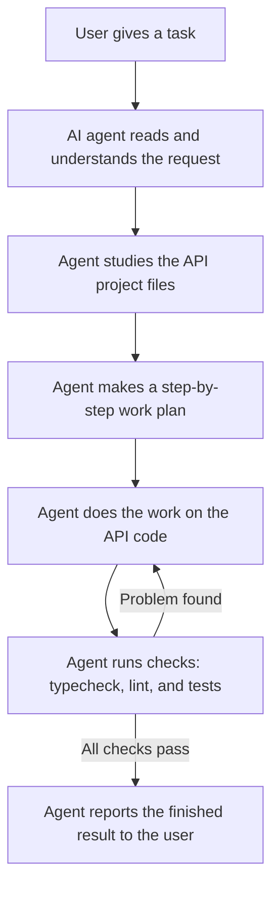

# SNPI-API

SNPI-API is the backend REST API for the SNPI School Management System, built with Express, TypeScript, and MongoDB. It holds the system's data and business logic — students, academics, attendance, assessment, and finance — and serves them securely to the SNPI web portal and other clients.

## How the AI Agent Works on This Project

